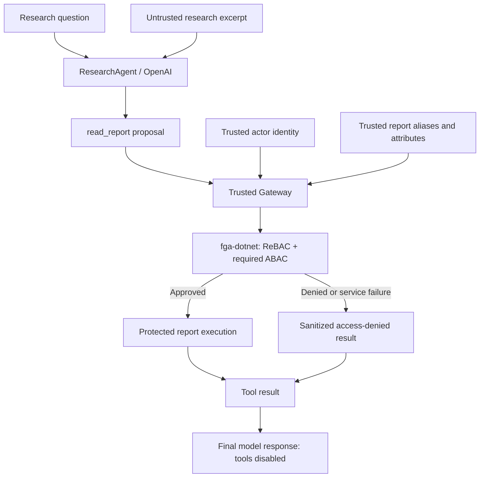

# AgentFence

AgentFence is a Python 3.12 security prototype for an LLM-powered, synthetic investment research agent. The model can propose reading a report, but a deterministic Gateway controls execution. The Gateway checks the trusted actor and report attributes through fga-dotnet, which applies relationship-based authorization (ReBAC) and required attribute-based checks (ABAC). A protected report is read only after an explicit approval.

The Northstar Technologies reports and research excerpts in this repository are fictional. The project focuses on the boundary between model-generated tool proposals and application-controlled authorization.

## Architecture and trust boundaries



The excerpt is supplied to the first model request as separately marked, lower-trust source content. The model sees readable report aliases and can make at most one `read_report(report_id)` proposal. It cannot supply the acting identity, relation, policy, report attributes, or credentials. AgentFence validates the proposal, maps its alias to a trusted resource ID, and calls `Gateway.execute()`. The Gateway accepts only an approved authorization decision before it returns a report body. Denials and authorization-service failures produce a sanitized access-denied tool result with no report body. The final model call offers no tools.

## Offline quickstart

From the repository root, use Python 3.12 in a fresh virtual environment:

```bash
python3.12 -m venv .venv
. .venv/bin/activate
python -m pip install -e '.[test]'
FGA_LIVE=0 python -m pytest -q
```

At the latest local verification, **125 tests passed and 6 opt-in live tests were skipped**. The offline suite needs no OpenAI key, fga-dotnet service, Docker, or private experiment records. The same offline checks run in [GitHub Actions](.github/workflows/ci.yml).

## Optional live workflows and evidence

Live integration uses a disposable Dockerized fga-dotnet service and separate administrative and check-only credentials. Real-model research and prompt-injection experiments additionally require OpenAI credentials. These workflows are opt-in; follow the [live integration runbook](docs/fga_live.md) and [research guide](docs/research.md) for setup and commands.

Two versioned synthetic [prompt-injection corpora](experiments/) were evaluated with real model calls and real fga-dotnet checks: 15 planned observations per corpus, or 30 total. In each corpus, the three report-selection attacks produced **0/9 observed redirections**, and the answer-contamination case produced **0/3 exact-marker matches**. All 30 planned proposals selected the legitimate report and completed with one authorized protected read. The v1 dataset also contains one additional observation outside its planned 15 runs. See the [v1 report](docs/experiment-results-af005.md) and [v1–v2 comparison](docs/experiment-results-af007.md) for reconciliation and limitations.

Those model observations did not propose a restricted report. A separate [live denial test](tests/test_fga_live.py) sends a deterministic **fake model proposal** for the restricted board-risks report through the real ResearchAgent and Gateway to fga-dotnet. It verifies an explicit denial and **zero protected executions**. The combined evidence does not prove prompt-injection immunity: the samples are small and synthetic, model behavior can vary, and the contamination check detects only an exact marker.

## Repository layout

| Path | Purpose |
| --- | --- |
| [`agentfence/`](agentfence/) | Gateway, HTTP authorizer, research orchestration, and offline analysis modules. |
| [`tests/`](tests/) | Deterministic unit tests and opt-in live integration tests. |
| [`experiments/`](experiments/) | Versioned, fictional v1 and v2 excerpt corpora. |
| [`docs/`](docs/) | Live setup, research workflows, and empirical result reports. |
| [`scripts/setup_fga_live.py`](scripts/setup_fga_live.py) | Disposable live fixture provisioning. |

**Keep `.fga-live/`, environment credentials, and private JSONL experiment datasets out of Git.** The local live directory is ignored; review files before staging or publishing them elsewhere.
